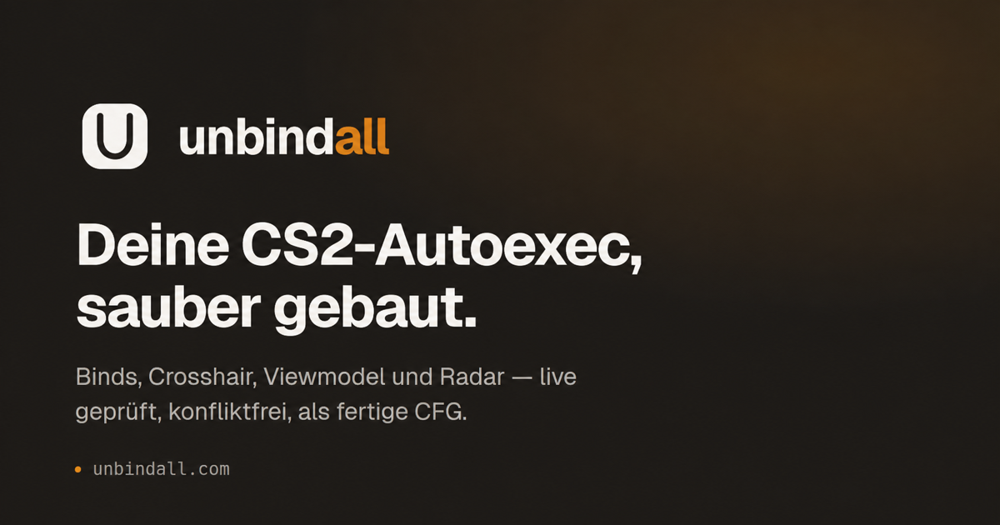

# Unbindall — CS2 Autoexec Generator

[](https://github.com/unbindall-org/unbindall/actions/workflows/ci.yml)

A responsive Next.js generator for Counter-Strike 2 autoexec files. Settings are searchable, can be inspected visually, imported from existing configuration files, downloaded, and saved to PostgreSQL through an Auth.js account.

> **Project status: pre-launch alpha.** The application is intentionally not hosted yet. This repository is public to validate community interest before paying for permanent infrastructure. The planned domain is `unbindall.com`; until a deployment is announced here, links claiming to host an official live instance should not be trusted.



## Features

- curated command catalog for competitive autoexecs, match servers, and offline practice
- six separate configuration types: Matchmaking, Practice, Server, Offline, Warmup, and Launch Options
- visible verification state per command: verified/deprecated, offline and cheat restrictions, and verified CS2 build
- persistent search by name, console command, and description
- live crosshair, radar, and viewmodel previews
- complete standard key bindings for movement, combat, weapons, grenades, communication, and the interface
- double/multi-bind module that assigns one action to two to four keys
- validated custom binds
- shared conflict detection across all binding modules
- lossless multi-file import for CFG, CS2 VCFG/KV1, and textual KV3; comments, aliases, and unknown commands are preserved
- type-specific live output, copy, and download for CFG files and launch options
- three quick-start presets
- anonymous browser drafts
- registration and sign-in through Auth.js credentials, Discord OAuth 2.0, and Steam OpenID 2.0
- passwords hashed with `bcrypt`
- multiple account-owned configurations in PostgreSQL with autosave and complete revision history
- Drizzle schema and versioned SQL migrations
- responsive desktop and mobile UI in English and German

## Quick start with Docker

The quickest way to try the complete application requires only Docker with Docker Compose. PostgreSQL, Redis, database migrations, and the Next.js app all start locally; no Neon, Discord, or Steam account is required.

1. Clone the repository and enter it:

   ```bash
   git clone https://github.com/unbindall-org/unbindall.git
   cd unbindall
   ```

2. Copy the ready-to-run local environment file:

   ```bash
   cp .env.docker.example .env.docker
   ```

3. Build and start the complete stack with one command:

   ```bash
   docker compose --env-file .env.docker up --build --wait
   ```

Open [http://localhost:3000](http://localhost:3000). The first build can take a few minutes; subsequent starts reuse Docker's build cache. Email/password registration works immediately. Discord and Steam sign-in stay hidden unless you add their optional credentials to `.env.docker`.

Useful follow-up commands:

```bash
docker compose --env-file .env.docker logs -f app      # follow application logs
docker compose --env-file .env.docker down             # stop the stack, keep local data
docker compose --env-file .env.docker down --volumes   # stop and delete all local data
```

PostgreSQL and Redis are accessible only inside the Compose network, and the app port is bound to loopback. Data survives normal restarts in Docker volumes. To use a port other than `3000`, change both `APP_PORT` and the port in `AUTH_URL` inside `.env.docker`, then restart the stack.

## Manual local setup

Requirements: Node.js 22 or newer, pnpm, and an existing Neon project.

```bash
cp .env.example .env
```

Add the connections from the Neon dashboard:

- `DATABASE_URL`: pooled URL for the running application; the hostname contains `-pooler`
- `DATABASE_MIGRATION_URL`: direct URL without `-pooler` for Drizzle migrations
- `REDIS_URL`: Redis connection for centralized, cross-instance rate limits

The direct migration connection follows Neon's recommendation. Both database URLs must contain `sslmode=require`. You must also replace `AUTH_SECRET`; for example, generate one with:

```bash
openssl rand -base64 32
```

Social sign-in buttons appear only when all variables for that provider are configured:

- Discord: set `AUTH_DISCORD_ID` and `AUTH_DISCORD_SECRET`. Register `http://localhost:3000/api/auth/callback/discord` in the Discord Developer Portal for local development, or `https://YOUR-DOMAIN/api/auth/callback/discord` in production.
- Steam: set `STEAM_WEB_API_KEY` from the Steam Web API key page. Steam sign-in uses OpenID 2.0, not OAuth. The app derives the realm and callback from `AUTH_URL`; they do not need separate registration with Steam.

`AUTH_URL` must exactly match the publicly reachable origin in every environment: `http://localhost:3000` locally or, for example, `https://unbindall.com` in production. In production, `AUTH_EXPECTED_HOST` must exactly match the expected hostname. Use `AUTH_TRUST_HOST=true` only behind a controlled reverse proxy; `TRUSTED_PROXY_COUNT` is the number of trusted proxy hops.

Then run:

```bash
pnpm install
pnpm db:migrate
pnpm db:seed:community # optional: Demo-Beiträge für die Community
pnpm dev
```

The app is available at [http://localhost:3000](http://localhost:3000).

## Commands

```bash
pnpm dev              # development server
pnpm typecheck        # strict TypeScript check
pnpm lint             # ESLint
pnpm test             # domain and serializer tests
pnpm test:db:up       # start the isolated PostgreSQL test database
pnpm test:integration # routers, migrations, auth, and cascades against PostgreSQL
pnpm test:e2e         # browser flows with Playwright/Chromium
pnpm test:container   # container smoke, database failure, and basic load test
pnpm test:db:down     # remove the test database and volumes
pnpm build            # type check and production build
pnpm db:generate      # generate a migration from the Drizzle schema
pnpm db:migrate       # apply pending migrations
pnpm db:seed:community # idempotent community demo data
pnpm db:studio        # open the database UI
```

## Data model

Auth.js uses the `users`, `accounts`, `sessions`, and `verification_tokens` tables. `configs` contains the current state, while `config_revisions` contains an immutable history of snapshots and patches. Active configuration names are unique per account. Normal deletion moves a configuration and its history to the trash; deleting an account cascades to sessions, provider accounts, configurations, and revisions. See [docs/versioning.md](docs/versioning.md) for the revision model.

`command_definitions` is the runtime source for the generator catalog. Migration `0006` imports the curated TypeScript catalog as a bilingual seed. Public reads use a sorted, tagged snapshot cached for 60 seconds; admin changes invalidate it immediately. The platform admin area manages catalog entries. Published command names are stable, concurrent updates use optimistic revisions, and drafts can be deleted only after being disabled.

Accounts have `user`, `moderator`, and `platform_admin` roles. Platform administrators can also open the moderator area and manage roles; moderators cannot access the admin area. Set the first platform administrator once after registration, for example with `UPDATE users SET role = 'platform_admin' WHERE email = 'admin@example.com';`. Further role changes happen in the admin area.

All sign-in methods use signed JWT cookies. Passwords are stored only as bcrypt hashes. Discord accounts are never linked automatically by email; linking requires an explicit action in an authenticated session under “Account & Data.” Steam identities are checked with a state cookie, a fresh OpenID nonce, and a server-side `check_authentication` request to Steam.

Redis rate-limits registration, credential sign-in, auth endpoints, the Steam start and callback, account deletion, exports, and configuration writes by IP and/or account. In production, protected operations fail closed when Redis is unavailable. Each account is limited to 25 configurations including trash and 10 MiB of logical data. Revision histories compact from 200 entries to the latest 100 states, and configuration documents accept at most 500 `commandValues`.

## Deployment

There is currently no official public deployment. The instructions below document the intended production setup for a later launch; the legal placeholders in `src/features/legal/site.ts` and `src/app/datenschutz/page.tsx` must be replaced with the actual operator and provider details first.

The server requires `DATABASE_URL`, `REDIS_URL`, `AUTH_SECRET`, `AUTH_URL`, `AUTH_EXPECTED_HOST`, and an explicit `AUTH_TRUST_HOST` decision. A trusted reverse proxy additionally requires `AUTH_TRUST_HOST=true` and `TRUSTED_PROXY_COUNT`. Discord requires `AUTH_DISCORD_ID` and `AUTH_DISCORD_SECRET` together; Steam optionally uses `STEAM_WEB_API_KEY`.

Production configuration is validated centrally at server startup. Weak secrets, HTTP origins, unexpected domains, unpooled or TLS-less database URLs, and inconsistent provider settings stop startup. Build or deployment environments also need `DATABASE_MIGRATION_URL` when they run migrations. Run `pnpm db:migrate` against the direct Neon connection before starting a new version. Auth.js and the configuration API require a Node.js runtime; a static export is not sufficient.

### Docker and Dokploy

The multi-stage `Dockerfile` builds Next.js as a standalone server. The final image contains neither source code nor development dependencies and runs as an unprivileged user on port `3000`. Test it locally with:

```bash
docker build -t unbindall .
docker run --rm -p 3000:3000 \
  -e DATABASE_URL='postgresql://…-pooler…/neondb?sslmode=require' \
  -e REDIS_URL='rediss://…' \
  -e AUTH_SECRET='…' \
  -e AUTH_URL='https://your-domain.example' \
  -e AUTH_EXPECTED_HOST='your-domain.example' \
  -e AUTH_TRUST_HOST='true' \
  -e TRUSTED_PROXY_COUNT='1' \
  unbindall
```

In Dokploy, configure the repository as an application with build type `Dockerfile`, Dockerfile path `Dockerfile`, and container port `3000`. No custom start command is required. Add these variables to the runtime environment:

```dotenv
DATABASE_URL=postgresql://…-pooler…/neondb?sslmode=require
REDIS_URL=rediss://…
AUTH_SECRET=…
AUTH_URL=https://your-domain.example
AUTH_EXPECTED_HOST=your-domain.example
AUTH_TRUST_HOST=true
TRUSTED_PROXY_COUNT=1
```

Optionally add the Discord and Steam variables described under “Local setup.” Do not pass secrets as Docker build arguments. The health check calls `/api/health`.

Migrations are intentionally not part of container startup so concurrent or restarted instances cannot run them simultaneously. Before deploying a version with schema changes, run this once in a controlled environment:

```bash
DATABASE_MIGRATION_URL='postgresql://…' pnpm db:migrate
```

## Contributing

Extension points and module boundaries are documented in [docs/architecture.md](docs/architecture.md). Read [CONTRIBUTING.md](CONTRIBUTING.md) and the [Code of Conduct](CODE_OF_CONDUCT.md) before opening your first pull request. New generator modules should include their data model, validation, and at least one serializer test.

See [CHANGELOG.md](CHANGELOG.md) for notable changes and [docs/releasing.md](docs/releasing.md) for versioning, tagging, and release conventions.

## License

Unbindall is free and open-source software licensed under the [GNU Affero General Public License v3.0](LICENSE).

The catalog scope and status model are documented in [docs/command-catalog.md](docs/command-catalog.md). The staged research, local CS2 verification, and post-update maintenance process is documented in the [catalog maintenance guide](docs/command-catalog-maintenance.md).
